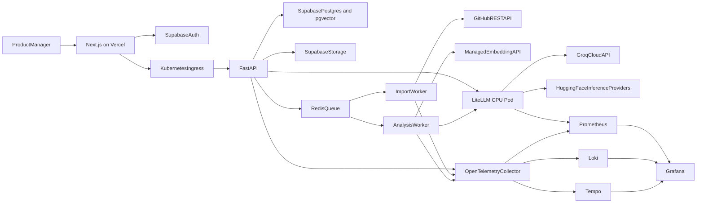
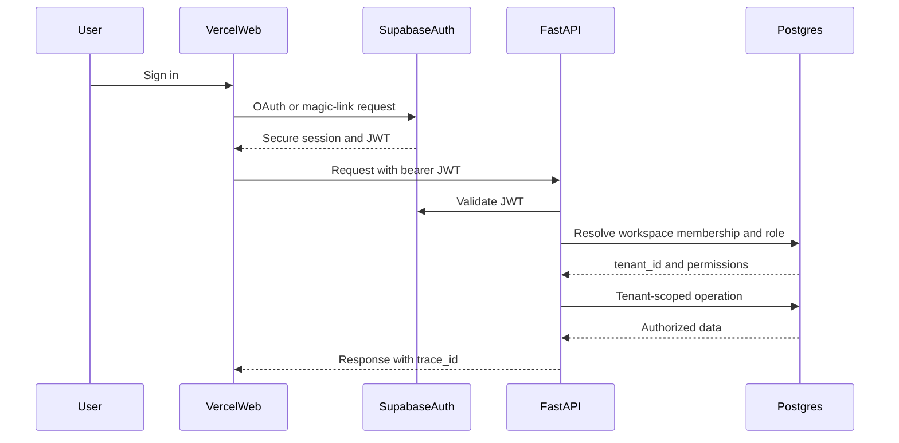
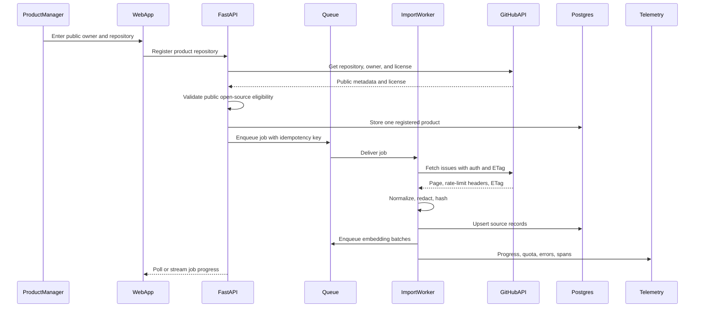
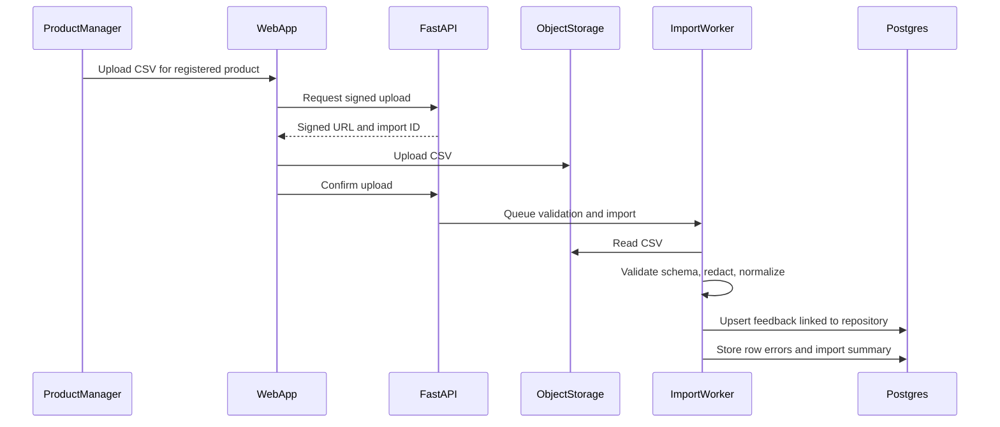
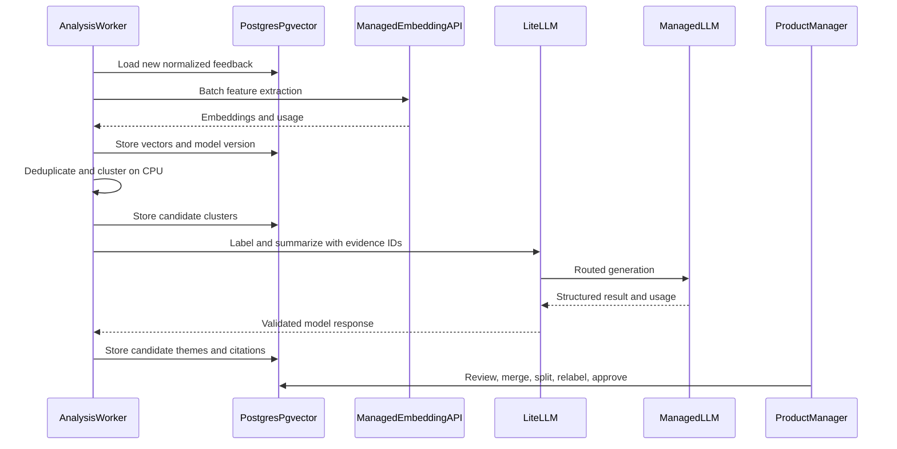
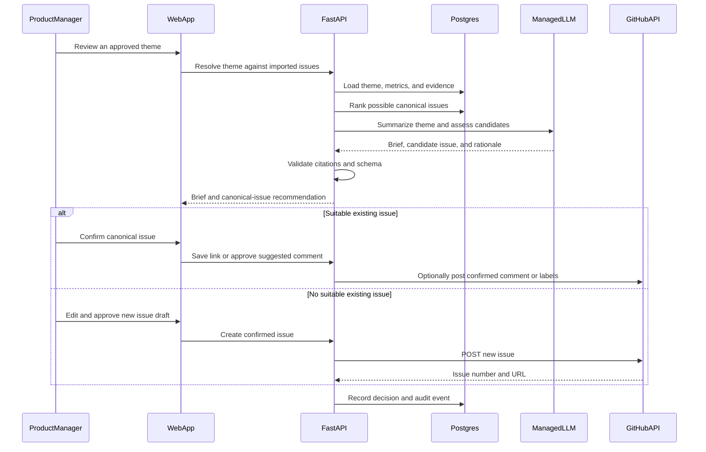
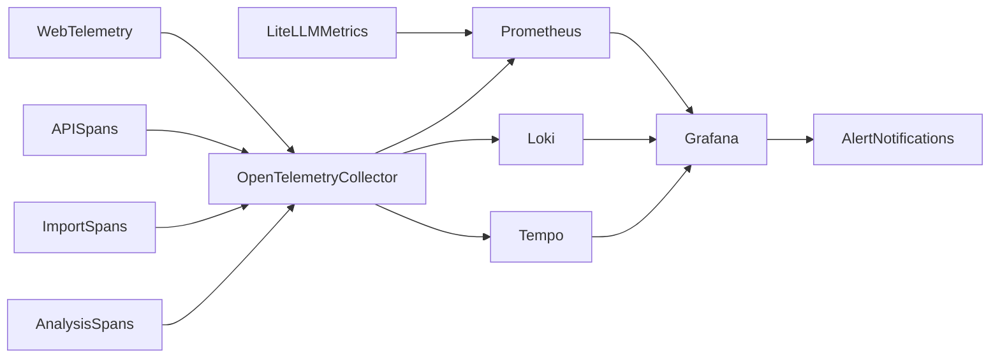

# Open-Source Product Feedback Intelligence Hub

> Complete implementation blueprint  
> Deployment principle: Kubernetes hosts CPU-only application services; Groq (free tier) and Hugging Face provide managed model inference. The project owns no GPU nodes and serves no model weights.  
> Research checked: October 11, 2026. Recheck provider models, prices, rate limits, and API versions before implementation.

## 1. Product summary

Build a product intelligence workspace exclusively for open-source companies whose products have public GitHub repositories. A user registers a public repository, the application imports its existing GitHub issues, and the user may upload a CSV containing customer feedback for that same product. The system groups related issues and CSV rows into themes, identifies an existing canonical issue for each theme when possible, and produces evidence-linked summaries and product briefs. It drafts a new GitHub issue only when an approved theme is not already represented by a suitable existing issue.

The project is more than sentiment analysis. It demonstrates a complete decision workflow:

`GitHub repository -> issues plus optional CSV -> normalized feedback -> themes -> canonical existing issue or reviewed new-issue draft`

### Hard scope boundary

The product accepts only:

- a public GitHub repository owned by an open-source company or organization;
- GitHub issues and issue comments from that registered repository;
- an optional CSV upload containing feedback about that same product.

The MVP rejects private repositories, non-GitHub sources, app-store scraping, generic survey connectors, support-platform connectors, and products without a detected open-source license. One workspace can register one product repository in the first release.

### Primary business use case

An open-source product manager enters `appwrite/appwrite`. The system validates that the repository is public and licensed, imports public issues, and combines them with an optional uploaded CSV of Appwrite customer feedback. For each discovered theme, it recommends one existing issue as the canonical record and summarizes the supporting issues and CSV rows. If no suitable issue exists, it may prepare a new issue draft for human approval.

### Target users

- Open-source founder or product manager: explores and prioritizes themes.
- Maintainer: reviews evidence and receives approved GitHub issue drafts.
- Community manager: monitors recurring requests and contributor pain points.
- Customer-success lead: uploads a CSV and compares private feedback with public issues.
- Workspace administrator: manages repository access, taxonomy, and users.

### Portfolio value

The project demonstrates:

- full-stack product and dashboard engineering;
- GitHub API ingestion, license validation, and webhook design;
- asynchronous data pipelines;
- managed embeddings and LLM generation;
- semantic deduplication, clustering, and trend analysis;
- human-in-the-loop AI workflows;
- provider routing with LiteLLM;
- CPU-only Kubernetes, Vercel, and managed data services;
- Prometheus, Grafana, logs, and distributed traces.

### Explicit non-goals for version 1

- No claim to automatically decide a product roadmap.
- No duplicate issue generation when a suitable canonical issue already exists.
- No autonomous GitHub comments, updates, or issue creation.
- No scraping app stores through unofficial APIs.
- No Zendesk, Intercom, Jira, Linear, Slack, or generic survey connector.
- No products without a public GitHub repository and recognized open-source license.
- No self-hosted language, embedding, or reranking model.
- No GPU node in Kubernetes.
- No private repositories in version 1.
- No fine-tuning.

---

## 2. Success criteria

The MVP is complete when:

1. A user can authenticate and access only their workspace.
2. A user can register a public GitHub repository and the system validates repository visibility, organization metadata, and license.
3. The system imports public issues and comments only from the registered repository.
4. A user can optionally upload CSV feedback explicitly associated with that repository’s product.
5. Imports are resumable, idempotent, and observable.
6. Feedback is normalized, redacted, embedded, and deduplicated.
7. A clustering job produces evidence-backed themes.
8. A user can merge, split, rename, relabel, approve, or dismiss themes.
9. The system shows volume, trend, source, product area, and representative comments.
10. An approved theme is linked to a suitable existing canonical issue whenever one exists.
11. The system can suggest a summary, labels, or comment for the canonical issue without posting automatically.
12. A new issue can be drafted only when no suitable canonical issue exists.
13. Posting a comment, updating labels, or creating an issue requires final user confirmation.
14. Grafana exposes ingestion, model, clustering, product, and cost metrics.
15. No project-managed GPU infrastructure exists.

Initial quality targets:

- Duplicate-pair F1: at least 0.85 on the labeled set.
- Taxonomy macro F1: at least 0.80.
- Theme summary citation precision: at least 0.95.
- Unsupported material claim rate: below 0.05.
- Cluster human correction rate: tracked and improving; no arbitrary fixed target before baseline.
- P95 import-item processing latency: measured and documented.
- Zero cross-tenant records in authorization tests.

---

## 3. Seed data strategy

### 3.1 Seed company: Appwrite

Use **Appwrite** as the single seed company and `appwrite/appwrite` as the seed repository.

Why it fits:

- Appwrite describes itself as an open-source development platform.
- The official repository is public at [github.com/appwrite/appwrite](https://github.com/appwrite/appwrite).
- The repository is licensed under the [BSD 3-Clause License](https://github.com/appwrite/appwrite/blob/main/LICENSE).
- Its public issue tracker contains bugs, feature requests, and community discussion.
- The product has clear areas for a taxonomy: Auth, Databases, Storage, Functions, Realtime, Messaging, Sites, SDKs, Console, and deployment.
- Appwrite’s contribution guide explicitly welcomes issues and product feedback.

The seed script must fetch current issues at setup time rather than commit a snapshot of third-party issue text. Default seed configuration:

```text
owner=appwrite
repository=appwrite
visibility=public
license=BSD-3-Clause
issue_states=open,closed
include_pull_requests=false
include_comments=true
```

The seed importer should start with a bounded, reproducible sample such as the most recently updated 500 issues, then record the query, import timestamp, and last seen issue update. A maintainer can increase the limit locally.

References:

- [Appwrite repository](https://github.com/appwrite/appwrite)
- [Appwrite issues](https://github.com/appwrite/appwrite/issues)
- [Appwrite contributing guide](https://github.com/appwrite/appwrite/blob/main/CONTRIBUTING.md)
- [Appwrite product documentation](https://appwrite.io/docs/products)

### 3.2 GitHub issue fields

Import:

- issue number and URL;
- title and body;
- labels;
- state and timestamps;
- reaction counts;
- comments when enabled;
- author pseudonym or one-way hash, not public profile details;
- ETag and last-modified metadata.

Exclude:

- pull requests returned by the Issues API;
- issues identified as security reports;
- deleted or unavailable comments;
- user email, avatar, and unrelated profile data;
- bot-only noise when it has no product-feedback value.

GitHub rate-limit facts from official documentation:

- unauthenticated REST requests are generally limited to 60 per hour;
- authenticated user requests are generally limited to 5,000 per hour;
- clients must honor `retry-after`, `x-ratelimit-remaining`, and `x-ratelimit-reset`;
- conditional authenticated requests that return `304 Not Modified` can conserve primary quota.

References:

- [GitHub REST authentication](https://docs.github.com/en/rest/authentication/authenticating-to-the-rest-api)
- [GitHub REST rate limits](https://docs.github.com/en/rest/using-the-rest-api/rate-limits-for-the-rest-api)
- [GitHub REST best practices](https://docs.github.com/en/rest/using-the-rest-api/best-practices-for-using-the-rest-api)

### 3.3 Appwrite customer-feedback CSV

Commit a clearly labeled synthetic fixture at:

`seed-data/appwrite-customer-feedback.csv`

The rows are fictional customer feedback written for this portfolio project. They are informed by Appwrite’s public product areas but must never be presented as statements from real Appwrite customers.

CSV fields:

- `feedback_id`
- `created_at`
- `source`
- `customer_segment`
- `product_area`
- `rating`
- `severity`
- `language`
- `is_synthetic`
- `feedback`

Seed known patterns:

- duplicate requests with varied wording;
- one emerging Realtime reliability theme whose volume increases by week;
- positive and negative feedback on the same feature;
- ambiguous comments;
- Auth, Databases, Storage, Functions, Realtime, Messaging, Sites, SDKs, Console, and deployment feedback;
- multilingual samples;
- comments that belong to multiple product areas.

The fixture provides deterministic evaluation cases and a repeatable upload demo. The UI must display a “Synthetic seed data” badge for every fixture row.

### 3.4 Labeled evaluation set

Manually create:

- 200–300 labeled duplicate/non-duplicate pairs;
- 100 comments with expected taxonomy labels;
- 10–15 expected themes with allowed members;
- expected trend direction for seeded themes;
- required evidence for five generated product briefs;
- unanswerable analysis questions.

Use GitHub labels only as weak labels. Human review defines evaluation truth.

### 3.5 Data ethics

- Display source attribution and links.
- Do not redistribute a third-party issue corpus in the repository.
- Provide an import script that fetches public records at setup time.
- Clearly identify the committed CSV as synthetic and unaffiliated with Appwrite.
- Do not imply that synthetic complaints describe actual Appwrite defects.
- Hash author identifiers and avoid avatars/emails.
- Remove security-sensitive issue content from the demo corpus.
- Support deletion by source ID.
- Document that public availability does not remove privacy and terms-of-use obligations.

---

## 4. Managed AI and analytics strategy

### 4.1 Model responsibilities

Use deterministic code where possible:

- normalization, language metadata, timestamps, and source mapping: code;
- exact duplicates: content hashes;
- vector similarity: managed embeddings plus `pgvector`;
- initial clustering: CPU-side clustering over stored vectors;
- taxonomy classification and cluster naming: managed LLM;
- theme summary and product brief: managed LLM with citations;
- trend score: SQL/statistical calculation, not an LLM;
- final priority: human decision.

The clustering algorithm runs on CPU in a worker. This is not model inference and requires no GPU. Start with hierarchical density-based clustering or graph-based threshold clustering after benchmarking on the labeled set.

### 4.2 Provider routing

Application-facing aliases:

- `feedback-labeler`
- `feedback-summarizer`
- `feedback-brief-writer`
- `feedback-embedding`
- `feedback-evaluator`

Recommended initial providers:

- Groq (GroqCloud free plan) for taxonomy, theme summaries, and product briefs. No credit card is required.
- Hugging Face Inference Providers for managed feature-extraction embeddings and as the fallback chat provider.
- LiteLLM as a CPU-only provider gateway for generation.
- A small backend embedding adapter for Hugging Face feature extraction, because Hugging Face’s OpenAI-compatible endpoint is chat-only and Groq does not offer an embeddings API.

| Alias | Primary model (Groq) | Fallback |
| --- | --- | --- |
| `feedback-labeler` | `openai/gpt-oss-20b` | `qwen/qwen3.8-27b` on Groq |
| `feedback-summarizer` | `openai/gpt-oss-120b` | `openai/gpt-oss-20b` on Groq, then Hugging Face |
| `feedback-brief-writer` | `openai/gpt-oss-120b` | `qwen/qwen3.8-27b` on Groq, then Hugging Face |
| `feedback-evaluator` | `openai/gpt-oss-20b` | `qwen/qwen3.8-27b` on Groq |
| `feedback-embedding` | Hugging Face feature extraction (not Groq) | none; never mix embedding models in one index |

Groq’s free plan limits are per organization **and per model**, so spreading aliases across models multiplies the usable daily budget. Discover the account’s active model IDs through `GET https://api.groq.com/openai/v1/models` at startup and fail readiness if a configured model is missing; the free-plan model list has changed several times in 2026.

### 4.3 Provider policy

- Pin model versions for repeatable cluster labels and reports.
- Store provider, model, prompt, taxonomy, and embedding versions.
- Never compare vectors produced by different embedding models in one index.
- Batch embeddings by provider limits.
- Retry only safe, idempotent calls with exponential backoff and jitter.
- Enforce per-import and monthly budgets.
- Run generation only after deterministic filtering has reduced the data volume.
- Cache cluster summaries by cluster membership hash.

### 4.4 Groq free-plan limits

Free-plan limits for each chat model at the time of research:

| Limit | `openai/gpt-oss-120b`, `openai/gpt-oss-20b`, `qwen/qwen3.8-27b` |
| --- | --- |
| Requests per minute | 30 |
| Requests per day | 1,000 |
| Tokens per minute | 8,000 |
| Tokens per day | 200,000 |

Design consequences:

- Tokens per minute is the binding limit. Keep each request under about 6,000 total tokens by sending a theme’s top representative items, not every member.
- Run all Groq calls through a single Redis-backed token-bucket limiter shared by the API and workers, keyed by model.
- Read `x-ratelimit-remaining-tokens`, `x-ratelimit-remaining-requests`, and `retry-after` from every response; on `429`, back off for `retry-after` and requeue the job instead of failing it.
- Budget estimate for the Appwrite seed (about 500 issues and 42 CSV rows): roughly 30–60 themes at about 4,000 tokens per summary comes to 120,000–240,000 tokens on `gpt-oss-120b`. That is one to two days of its free quota. Labeling uses `gpt-oss-20b`, which has its own separate quota.
- Exported metrics: remaining tokens and requests per model, `429` count, and queued generation jobs.
- If the project outgrows the free plan, Groq’s paid Developer plan is the cheapest upgrade (`gpt-oss-20b` at $0.075 input and $0.30 output per million tokens). Only configuration changes.

### 4.5 Hugging Face cost caveat

Do not design around an assumed permanent free tier. The current stable Hugging Face pricing page says free users receive no recurring included Inference Providers credit and must purchase credits or upgrade; Pro users receive a small monthly credit. Other documentation may show a small, changeable trial credit. The application must work with paid usage and hard limits.

---

## 5. Production architecture

### 5.1 Deployment topology



### 5.2 Authentication flow



### 5.3 GitHub import flow



### 5.4 Optional CSV upload flow



The API rejects a CSV unless the workspace already has a validated repository. Every imported row inherits the registered product ID; users cannot mix unrelated products in one workspace.

### 5.5 Analysis and theme flow



### 5.6 Theme resolution and GitHub action flow



The default demo is read-only: it saves the canonical link or new-issue draft locally. GitHub write access is optional and requires a GitHub App installation with Issues permission plus explicit confirmation for every comment, label change, or new issue.

### 5.7 Observability flow



---

## 6. Technology stack

### Frontend

- Next.js with App Router
- TypeScript
- Tailwind CSS and shadcn/ui
- TanStack Query
- TanStack Table
- Recharts or Apache ECharts
- React Hook Form and Zod
- Supabase browser/server clients
- Playwright

### Backend and workers

- Python 3.13 or current supported version
- FastAPI, Uvicorn, and Pydantic
- SQLAlchemy 2, Alembic, and `psycopg`
- `httpx`
- LiteLLM proxy
- managed Redis with Dramatiq, Celery, or RQ
- pandas and Polars for import processing
- scikit-learn plus a selected clustering package
- `numpy`
- OpenTelemetry and Prometheus client
- pytest, Ruff, and mypy

### Managed services

- Vercel: web application.
- Supabase: Auth, PostgreSQL, `pgvector`, and object storage.
- Groq: primary managed language models on the free plan.
- Hugging Face Inference Providers: managed embeddings and fallback language models.
- Upstash or another managed Redis: queues.
- Grafana Cloud or the Grafana stack in CPU Kubernetes.
- GitHub REST API: repository validation, issue ingestion, and optional confirmed comments, labels, or new-issue creation.

### Platform

- Docker Desktop
- Kubernetes with CPU nodes only
- `kubectl`, Helm, and `kind`/`k3d`
- GitHub Actions
- Trivy
- k6

---

## 7. Required installations and accounts

### Local tools

Install:

1. Git
2. Node.js LTS and `pnpm`
3. Python and `uv`
4. Docker Desktop
5. `kubectl`
6. Helm
7. `kind` or `k3d`
8. Supabase CLI
9. Vercel CLI
10. Optional GitHub CLI
11. Gitleaks
12. Trivy
13. `actionlint`
14. `kubeconform`
15. Conftest
16. Syft and Cosign for local supply-chain verification

### Accounts

Create:

- Vercel project.
- Supabase project.
- Groq account and API key from [console.groq.com/keys](https://console.groq.com/keys) (free plan, no card).
- Hugging Face account and inference token.
- GitHub App or fine-grained token for development imports.
- Managed Redis instance.
- Grafana Cloud stack if telemetry is hosted.

Prefer a GitHub App for a production multi-user integration. It can begin with read-only repository metadata and Issues access, then request write access only when the user enables confirmed comments, label changes, or new-issue creation. A fine-grained personal access token is acceptable for the initial read-only portfolio import.

### Core dependencies

Frontend:

```bash
pnpm add @supabase/ssr @supabase/supabase-js @tanstack/react-query @tanstack/react-table
pnpm add zod react-hook-form recharts
pnpm add -D @playwright/test vitest @testing-library/react @testing-library/jest-dom
pnpm add -D eslint prettier typescript
```

Backend:

```bash
uv add fastapi uvicorn pydantic sqlalchemy alembic psycopg httpx litellm redis
uv add pandas polars numpy scikit-learn
uv add opentelemetry-sdk opentelemetry-instrumentation-fastapi prometheus-client
uv add --dev pytest pytest-asyncio pytest-cov respx ruff mypy pip-audit
```

Choose and lock the queue and clustering packages after a benchmark spike.

---

## 8. External API inventory

### Required for MVP

#### GitHub REST API

- Purpose: validate open-source repositories, import public issues/comments, and optionally perform a user-confirmed action on a canonical issue.
- Authentication: bearer token or GitHub App installation token.
- Required operations:
  - get repository metadata;
  - get repository license;
  - get organization metadata when the owner is an organization;
  - list repository issues;
  - list issue comments when enabled;
  - inspect rate-limit status;
  - later receive issue webhooks;
  - optionally comment on or label a canonical issue after confirmation;
  - create a new issue only after duplicate checking and explicit confirmation.
- Implementation:
  - reject private repositories and missing/unrecognized licenses;
  - reject pull requests returned by the Issues endpoint;
  - use pagination;
  - use ETags and conditional requests;
  - honor rate-limit and retry headers;
  - checkpoint the last successful page;
  - deduplicate by repository and issue ID.

#### Supabase

- Purpose: Auth, sessions, relational data, vectors, and import-file storage.
- Browser receives only the publishable key.
- Worker/API receive server credentials through Kubernetes secrets.
- Enable RLS on every browser-exposed table.
- References:
  - [Supabase Next.js Auth](https://supabase.com/docs/guides/auth/quickstarts/nextjs)
  - [Supabase RLS](https://supabase.com/docs/guides/database/postgres/row-level-security)
  - [Supabase pgvector](https://supabase.com/docs/guides/database/extensions/pgvector)

#### Groq

- Base URL: `https://api.groq.com/openai/v1` (OpenAI-compatible chat completions).
- Authentication: bearer API key (`GROQ_API_KEY`). It is held only by the LiteLLM pod; the API and workers call LiteLLM with virtual keys.
- Purpose: taxonomy labels, theme summaries, product briefs, and evaluator checks. No embeddings.
- Use JSON-schema structured outputs and still validate every response with Pydantic, including evidence IDs.
- Discover account-visible model IDs through `/models`.
- References:
  - [Groq models](https://console.groq.com/docs/models)
  - [Groq rate limits](https://console.groq.com/docs/rate-limits)
  - [Groq structured outputs](https://console.groq.com/docs/structured-outputs)

#### Hugging Face Inference Providers

- Authentication: bearer token with inference permission.
- Purpose: feature-extraction embeddings and alternate generation models.
- Important: OpenAI compatibility is for chat; embeddings use the native API.
- References:
  - [Inference Providers](https://huggingface.co/docs/inference-providers/en/index)
  - [Feature extraction API](https://huggingface.co/docs/inference-providers/tasks/feature-extraction)
  - [Pricing](https://huggingface.co/docs/inference-providers/pricing)

#### LiteLLM internal gateway

- Cluster-private OpenAI-compatible route.
- Virtual keys per environment and service.
- Provider aliases, budgets, fallback, token accounting, and metrics.
- References:
  - [LiteLLM gateway](https://docs.litellm.ai/docs/simple_proxy)
  - [Spend tracking](https://docs.litellm.ai/docs/proxy/cost_tracking)
  - [Prometheus integration](https://docs.litellm.ai/docs/proxy/prometheus)

### GitHub write access after MVP

- Keep the default installation read-only.
- Request Issues write permission only when a workspace enables export.
- Show the canonical issue, proposed comment/labels, or new issue title/body before confirmation.
- Prefer linking or updating an existing canonical issue.
- Create with `POST /repos/{owner}/{repo}/issues` only when no suitable issue exists.
- Store the action type, issue number, URL, and idempotency record.
- Never write to GitHub directly from an unreviewed model response.
- Reference: [GitHub REST issue endpoints](https://docs.github.com/en/rest/issues/issues)

---

## 9. Application API

Initial routes:

- `GET /health/live`
- `GET /health/ready`
- `GET /metrics`
- `GET /v1/me`
- `GET /v1/product`
- `POST /v1/product/github`
- `POST /v1/product/csv`
- `POST /v1/imports`
- `GET /v1/imports/{import_id}`
- `POST /v1/imports/{import_id}/cancel`
- `GET /v1/feedback`
- `GET /v1/feedback/{feedback_id}`
- `GET /v1/themes`
- `POST /v1/themes/analyze`
- `GET /v1/themes/{theme_id}`
- `POST /v1/themes/{theme_id}/merge`
- `POST /v1/themes/{theme_id}/split`
- `POST /v1/themes/{theme_id}/decision`
- `POST /v1/themes/{theme_id}/canonical-issue`
- `POST /v1/themes/{theme_id}/briefs`
- `POST /v1/themes/{theme_id}/github-action`
- `GET /v1/analytics/trends`
- `GET /v1/analytics/quality`
- `GET /v1/analytics/usage`

Mutations use idempotency keys. Every response propagates a trace ID.

---

## 10. Data model

Core tables:

- `tenants`
- `users`
- `memberships`
- `products`
- `github_repositories`
- `github_installations`
- `repository_license_checks`
- `imports`
- `import_checkpoints`
- `feedback_items`
- `feedback_revisions`
- `feedback_embeddings`
- `duplicate_edges`
- `analysis_runs`
- `candidate_clusters`
- `themes`
- `theme_members`
- `theme_citations`
- `theme_decisions`
- `taxonomy_versions`
- `product_briefs`
- `exports`
- `model_runs`
- `prompt_versions`
- `audit_events`

Key rules:

- Every tenant record requires `tenant_id`.
- A tenant has exactly one registered product in version 1.
- A product requires one public GitHub repository with a recognized SPDX open-source license.
- Store the repository owner, name, node ID, visibility, default branch, license SPDX ID, and last validation time.
- Revalidate public visibility and license before each full synchronization.
- CSV imports require the existing product ID and cannot create a second product.
- Source plus external ID is unique for idempotent imports.
- Raw and normalized text are stored separately.
- Redaction occurs before provider calls.
- Embeddings include provider, model, dimension, and version.
- A new embedding model creates a new vector version/index.
- Cluster membership is versioned by analysis run.
- Human-approved themes are not silently overwritten by a later analysis run.
- Audit events are append-only.

---

## 11. Analysis design

### Repository eligibility gate

When a user enters `owner/repository`:

1. Call the GitHub repository endpoint and require `private=false`.
2. Require an organization owner for the MVP; reject personal-account repositories.
3. Call the license endpoint and require a recognized SPDX license from the project allowlist.
4. Require Issues to be enabled.
5. Reject archived or disabled repositories.
6. Store the immutable GitHub repository node ID to prevent rename confusion.
7. Present the detected organization, repository, license, and issue count for user confirmation.
8. Create the product only after confirmation.

Initial license allowlist can include OSI-recognized permissive and copyleft licenses such as Apache-2.0, BSD-2-Clause, BSD-3-Clause, GPL-2.0, GPL-3.0, LGPL variants, AGPL-3.0, MIT, MPL-2.0, and EPL-2.0. Keep the allowlist versioned and link to the detected license; do not make legal conclusions beyond the repository metadata.

### Normalization pipeline

1. Validate source schema.
2. Canonicalize whitespace and markup.
3. Detect language.
4. Detect and redact PII.
5. Remove empty/spam records using deterministic rules.
6. Compute exact-content hash.
7. Generate managed embeddings.
8. Store normalized record and provenance.

### Deduplication

- Exact hash match first.
- Candidate nearest neighbors from `pgvector`.
- Pairwise threshold or lightweight classifier for semantic duplicates.
- Preserve every original record; duplicate groups are derived data.

### Clustering

Benchmark:

- graph connected components at a similarity threshold;
- agglomerative clustering;
- HDBSCAN or equivalent density-based method.

Select using labeled pair quality, cluster purity, stability, runtime, and human correction rate. Do not select from visual appeal alone.

### Theme scoring

Compute deterministically from:

- unique feedback count;
- recent growth;
- source diversity;
- customer segment weight;
- severity or rating;
- duplicate-adjusted volume;
- confidence and data completeness.

Show every factor. Do not ask the LLM for a hidden “priority score.”

### Canonical issue resolution

For every approved theme:

1. Collect the imported GitHub issues already assigned to the theme.
2. Rank open issues before closed issues, then consider semantic coverage, labels, reactions, recency, and discussion activity.
3. Recommend the strongest existing issue as the canonical issue.
4. Show the recommendation and evidence to a maintainer; never merge or close duplicates automatically.
5. For an existing canonical issue, suggest a concise evidence summary, labels, or comment that incorporates related CSV feedback.
6. Allow a new issue draft only when the maintainer selects “No suitable existing issue.”
7. Before creation, run a final similarity search against all current open issues and warn about likely duplicates.
8. Require explicit confirmation for any GitHub write operation.

This makes GitHub issues input evidence and existing work records. It does not convert imported issues into additional issues.

### LLM output schema

Theme output:

- title;
- concise summary;
- product area;
- feedback type;
- affected users;
- evidence IDs;
- unresolved contradictions;
- confidence reason.

Product brief output:

- problem statement;
- user impact;
- evidence summary;
- non-goals;
- proposed acceptance criteria;
- open questions;
- source links.

GitHub resolution output:

- recommended canonical issue ID or `none`;
- rationale supported by evidence IDs;
- likely duplicate issue IDs;
- suggested labels;
- optional comment draft for an existing canonical issue;
- new issue title and body only when no suitable canonical issue exists.

---

## 12. Security and privacy

- Validate Supabase JWT issuer, audience, signature, and expiry.
- Resolve tenant membership server-side.
- Use RLS and API authorization.
- Encrypt GitHub, Groq, and Hugging Face tokens.
- Use least-privilege GitHub scopes and keep write access optional.
- Treat imported text as untrusted prompt content.
- Strip instructions from source text by policy; never execute imported links or code.
- Redact personal data before model calls.
- Keep author identities pseudonymous.
- Validate model evidence IDs against server-provided candidates.
- Restrict CSV size, type, and row count.
- Protect against spreadsheet formula injection on exports.
- Verify webhook signatures and deduplicate deliveries.
- Implement source deletion through raw, normalized, vector, cluster, and cache layers.

Threat tests:

- cross-tenant similarity search;
- prompt injection in an issue body;
- malicious CSV formulas;
- GitHub token with insufficient scope;
- private, missing, archived, or unlicensed repository registration;
- CSV uploaded before repository validation or containing unrelated product data;
- rate-limit exhaustion;
- duplicate webhook delivery;
- fabricated citations;
- cluster data poisoning;
- provider partial outage.

---

## 13. Observability

### Prometheus metrics

Ingestion:

- imported, skipped, updated, and failed records;
- page latency and source rate-limit remaining;
- import queue age, retries, and checkpoints;
- PII redaction count by category, without content.

Analysis:

- embedding batch size, latency, failure, token/unit use, and cost;
- exact and semantic duplicate rates;
- clustering duration and records processed;
- cluster count and size distribution as histograms;
- LLM labeling/summarization latency, errors, tokens, and cost;
- schema and citation validation failures.

Product:

- theme approvals, dismissals, merges, splits, and relabels;
- brief generation, edits, approval, and export;
- correction rate by analysis version.

Platform:

- request traffic, errors, and latency;
- queue saturation;
- database pool usage;
- pod CPU, memory, restarts, and availability.

Avoid IDs, free text, repository names, and user names as metric labels.

### Logs

Structured fields:

- timestamp;
- environment and service;
- trace, request, import, and analysis-run IDs;
- pseudonymous tenant key;
- normalized operation;
- provider and model alias;
- row counts, latency, tokens, and cost;
- error category.

Never log raw feedback, OAuth tokens, model prompts, embeddings, or generated briefs by default.

### Traces

Trace:

- GitHub page fetch through normalized database upsert;
- embedding batch through vector storage;
- analysis run through clustering and labeling;
- theme resolution through canonical-issue linking and any confirmed GitHub write.

### Grafana dashboards

1. API and Kubernetes service health.
2. Import throughput, quotas, retries, and failures.
3. Embedding, clustering, and analysis health.
4. LLM provider quality, latency, failures, fallback, tokens, and spend.
5. Product outcomes and human correction rates.

### Alerts

- source import stalled;
- GitHub quota unexpectedly low;
- queue age or dead letters elevated;
- embedding or generation provider failure spike;
- model spend threshold reached;
- cluster count or duplicate rate changes abnormally after a release;
- citation or schema validation regression.

---

## 14. Repository structure

```text
apps/
  web/
  api/
  import-worker/
  analysis-worker/
.github/
  workflows/
    branch-ci.yml
    pr-ci.yml
    security.yml
    cd-staging.yml
    cd-production.yml
  dependabot.yml
services/
  litellm/
packages/
  contracts/
  evaluation/
  taxonomy/
infra/
  helm/
  kubernetes/
  grafana/
  prometheus/
supabase/
  migrations/
  seed/
seed-data/
  appwrite-customer-feedback.csv
  appwrite-github-source.json
fixtures/
  evaluations/
tests/
  unit/
  integration/
  e2e/
  contracts/
docs/
  adr/
  data-ethics/
  threat-model/
  runbooks/
```

---

## 15. CI/CD, tests, and quality gates

### 15.1 Branch and pull-request policy

Use short-lived feature branches and pull requests into a protected `main` branch.

Repository rules:

- block direct pushes to `main`;
- require at least one approving review;
- dismiss stale approvals when code changes;
- require all CI checks to pass;
- require conversations to be resolved;
- require the branch to be current with `main`;
- prevent force pushes and branch deletion;
- apply `CODEOWNERS` to workflows, infrastructure, database migrations, and security-sensitive code;
- require signed commits only if it does not create unnecessary contributor friction.

GitHub Actions triggers:

- every branch push: fast lint, formatting, type, unit, seed-data, and secret checks;
- every pull request targeting `main`: complete test, security, build, and infrastructure validation;
- merge to `main`: build immutable artifacts and deploy to staging;
- production: manual approval through a protected GitHub Environment;
- nightly/scheduled: live-provider smoke tests, full CodeQL scan, dependency checks, and evaluation regression.

Use workflow concurrency to cancel obsolete runs for the same branch.

### 15.2 CI/CD flow


### 15.3 Fast checks on every branch push

The `branch-ci.yml` workflow runs without production secrets:

Frontend:

- Prettier format check;
- ESLint;
- TypeScript type checking;
- Vitest unit tests with coverage;
- validation that the Next.js production build compiles.

Python services:

- Ruff formatting check and lint;
- mypy type checking;
- pytest unit tests with coverage;
- import-cycle and dead-code checks if they remain low-noise.

Repository:

- Gitleaks scan over the commit range;
- JSON, YAML, Markdown, and CSV syntax validation;
- parse `appwrite-github-source.json`;
- verify every CSV row matches the schema and has `is_synthetic=true`;
- verify unique seed IDs and accepted taxonomy values;
- `actionlint` for GitHub Actions workflows.

Fast checks should target completion in approximately five minutes.

### 15.4 Full pull-request checks

The `pr-ci.yml` workflow adds:

#### Unit tests

Web:

- components, hooks, form validation, and state transitions;
- canonical-issue decision UI;
- confirmation guard before GitHub writes;
- API client error and retry behavior.

Backend:

- repository eligibility and license allowlist;
- GitHub pagination, ETag, rate-limit, and pull-request filtering;
- CSV schema validation, PII redaction, and formula-injection protection;
- normalization, exact deduplication, similarity thresholds, and theme scoring;
- canonical-issue ranking and final duplicate warning;
- LLM output schema and evidence-ID validation;
- authorization, idempotency, and budget rules.

#### Integration tests

Start disposable PostgreSQL with `pgvector` and Redis service containers. Run:

- all migrations from an empty database;
- rollback/forward migration validation where supported;
- tenant RLS and cross-tenant isolation tests;
- API plus worker queue processing;
- CSV upload through normalized feedback persistence;
- GitHub import using a local mock server with pagination, ETags, `403`, `429`, and retry headers;
- Groq, Hugging Face, and LiteLLM interactions through recorded or mocked HTTP contracts, including Groq `429` responses with `retry-after`;
- embedding storage, similarity query, clustering job, and theme persistence;
- canonical-issue linking and a blocked duplicate-creation scenario;
- audit-event and OpenTelemetry propagation.

PR tests must not call paid model APIs or write to GitHub. Use deterministic fixtures with `respx`, WireMock, or an equivalent HTTP mock.

#### End-to-end tests

Run a small Playwright suite against the containerized stack:

1. sign in with a test identity;
2. register the mocked `appwrite/appwrite` repository;
3. upload the synthetic Appwrite CSV;
4. wait for import and analysis jobs;
5. inspect a theme and its evidence;
6. select an existing canonical issue;
7. verify that creating a duplicate issue is not offered;
8. test the separate path where no existing issue is suitable;
9. verify final confirmation is required.

### 15.5 Security and supply-chain checks

Run:

- Gitleaks for committed secrets and high-entropy credentials;
- GitHub Secret Scanning and push protection when available;
- CodeQL for JavaScript/TypeScript and Python;
- GitHub Dependency Review on pull requests;
- Dependabot for npm, Python, Docker, Helm, and GitHub Actions updates;
- `npm audit` or an equivalent lockfile audit;
- `pip-audit` or OSV-Scanner for Python dependencies;
- Trivy filesystem and container-image vulnerability scans;
- Semgrep rules for common web, Python, and secrets mistakes if the findings remain actionable;
- license-policy checks for dependencies;
- SBOM generation with Syft or Trivy;
- keyless container signing and verification with Cosign.

Fail the build for:

- any detected credential;
- critical known vulnerabilities with an available fix;
- high-severity findings that violate the documented policy;
- unsigned production images;
- dependencies with prohibited licenses.

Time-bound suppressions require a reason, owner, and expiry date in version control.

### 15.6 Container and Kubernetes validation

For every pull request:

- build all Docker images without pushing them;
- run container health checks;
- scan images with Trivy;
- run `helm lint`;
- render charts with `helm template`;
- validate rendered resources with `kubeconform`;
- enforce policies with Conftest/OPA or Kyverno tests;
- reject privileged containers, mutable image tags, missing probes, missing resource requests/limits, host networking, and secrets embedded in manifests;
- verify every application workload is CPU-only.

Use a temporary `kind` cluster for a focused deployment smoke test when runtime permits.

### 15.7 Quality and coverage policy

- Publish frontend and backend coverage reports as workflow artifacts.
- Start with a 75% line-coverage floor, then raise it for core domain modules.
- Require higher branch coverage for authorization, canonical-issue selection, duplicate prevention, and GitHub write guards.
- Do not chase coverage through meaningless tests.
- Upload JUnit, Playwright, security, image-scan, and evaluation reports.
- Add a PR summary containing changed services and failed quality gates.

### 15.8 AI-specific tests

Deterministic PR checks:

- JSON/schema conformance;
- evidence IDs exist and belong to the tenant/theme;
- imported text cannot override system policy;
- canonical-issue recommendation comes from imported candidates;
- no new issue draft appears when a suitable canonical issue is selected;
- provider timeout, malformed output, and budget exhaustion;
- prompt and model version recorded for every run.

Scheduled tests with strict provider budgets:

- small Groq and Hugging Face connectivity smoke tests (one short request each, to protect free-plan quotas);
- held-out duplicate, taxonomy, citation, and groundedness evaluations;
- regression comparison against the latest accepted baseline;
- alert when quality drops beyond a defined tolerance.

Store evaluation results, not sensitive prompts or customer content, as CI artifacts.

### 15.9 Continuous delivery

#### Pull-request environments

- Vercel creates a frontend preview.
- Preview builds use mock AI providers and isolated test data.
- Forked pull requests receive no repository or deployment secrets.
- Never expose Supabase service-role, Groq, Hugging Face, GitHub App private keys, or Kubernetes credentials to preview code.

#### Staging

After merge to `main`:

1. build each image exactly once;
2. tag it with the immutable Git commit SHA;
3. push to GitHub Container Registry;
4. generate an SBOM and sign the image;
5. update/deploy the staging Helm release using the same digest;
6. run database migrations as a controlled pre-deploy job;
7. run API, worker, queue, authentication, and mock-provider smoke tests;
8. verify metrics, logs, and traces reach Grafana.

#### Production

- Use a protected GitHub Environment with manual approval.
- Promote the already-tested image digest; never rebuild for production.
- Authenticate to cloud services through GitHub OIDC/workload identity instead of long-lived cloud keys.
- Run migration compatibility checks before rollout.
- Use rolling or canary deployment with readiness checks.
- Run post-deploy smoke and synthetic monitoring.
- Automatically stop promotion on SLO or smoke-test failure.

Rollback:

- roll back the Helm release to the previous signed image digest;
- keep database migrations backward compatible across at least one release;
- document restore procedures for non-reversible migrations;
- retain deployment metadata, approver, image digest, and migration version.

### 15.10 Workflow security

- Set default `GITHUB_TOKEN` permissions to read-only.
- Grant job-specific permissions explicitly.
- Pin third-party actions to full commit SHAs and update them through Dependabot.
- Never use untrusted PR code in a privileged `pull_request_target` job.
- Separate build, signing, and deployment jobs.
- Protect production environments and secrets with required reviewers.
- Mask sensitive values and prevent raw model/provider payloads from appearing in logs.
- Keep deployment credentials out of repository secrets when OIDC is available.

### 15.11 Required status checks

Configure branch protection to require:

- `frontend-quality`
- `backend-quality`
- `unit-tests`
- `integration-tests`
- `e2e-smoke`
- `seed-data-validation`
- `secret-scan`
- `dependency-review`
- `codeql`
- `container-build-scan`
- `helm-policy-validation`

Scheduled provider smoke tests should alert maintainers but should not block unrelated pull requests.

---

## 16. Delivery roadmap

### Milestone 1: workspace foundation

- GitHub repository, protected `main`, CODEOWNERS, Dependabot, and required status checks.
- Monorepo, local containers, branch CI, PR CI, linting, unit tests, and integration-test harness.
- Supabase Auth, tenant memberships, and roles.
- Repository eligibility, product registration, and import-job UI.
- Appwrite seed configuration and synthetic CSV loader.

### Milestone 2: reliable ingestion

- CSV validation and asynchronous import.
- Appwrite issue seed import plus configurable GitHub authenticated pagination, ETags, checkpoints, and rate-limit handling.
- Normalization, PII redaction, provenance, and idempotent upserts.
- Import dashboard and failure recovery.

### Milestone 3: embeddings and similarity

- Managed embedding adapter.
- Vector schema and versioning.
- Exact and semantic duplicate pipeline.
- Labeled-pair evaluation report.

### Milestone 4: clustering and themes

- Benchmark candidate clustering methods.
- Candidate themes with deterministic trends.
- Groq labeling/summarization through LiteLLM with the shared rate limiter.
- Human merge, split, relabel, approve, and dismiss workflow.

### Milestone 5: product briefs

- Evidence-linked structured brief.
- Editing and version history.
- Canonical-issue recommendation and duplicate warning.
- Optional confirmed comment/label update for an existing issue.
- New issue draft only when no suitable existing issue exists.
- Audit trail.

### Milestone 6: production deployment

- Helm charts for API, workers, and LiteLLM.
- CPU requests/limits, probes, network policies, ingress, TLS, and secrets.
- Vercel frontend and secured API access.
- Managed Redis and Supabase production configuration.
- Signed SHA-tagged images, SBOMs, staging deployment, smoke tests, and protected production promotion.

### Milestone 7: observability and evaluation

- OpenTelemetry, Prometheus, Loki, Tempo, and Grafana.
- Quality, latency, cost, and cluster-correction reports.
- Provider and connector failure tests.
- k6 load tests.
- CodeQL, dependency review, Gitleaks, Trivy, Helm/Kubernetes policy checks, and rollback drill.

### Milestone 8: portfolio release

- Architecture decision records.
- Data ethics and threat-model documents.
- Reproducible public-data import.
- Demo video showing import through approved product brief.
- Exact monthly-cost breakdown and stated limitations.

---

## 17. Cost-control plan

- No GPU infrastructure.
- CPU-only Kubernetes services.
- Embed each content hash once.
- Process only new or changed records.
- Batch managed embedding calls.
- Summarize clusters, not individual comments.
- Cache theme output by membership hash.
- Use deterministic taxonomy rules before LLM classification.
- Put per-import record and cost limits in the UI.
- Configure LiteLLM and provider hard budgets.
- Stay within Groq’s free plan: limit tokens per request, rate-limit per model, and pause generation jobs once the daily token budget is used up.
- PR CI never calls Groq; all model calls are mocked.
- Disable anonymous imports and analysis.
- Run large evaluation jobs manually or on schedule.

The main cost drivers are managed embedding volume, generated theme/brief tokens, database/vector storage, and always-on CPU Kubernetes nodes—not GPU ownership.

---

## 18. Key architecture decisions

Record:

- managed inference instead of self-hosted models;
- Groq free plan as the primary generation provider instead of paid xAI, accepting tighter rate limits;
- LiteLLM for generation routing and spend control;
- separate embedding adapter because Hugging Face chat compatibility does not cover embeddings;
- Supabase for Auth, database, vectors, and storage;
- public organization-owned GitHub repositories as the only supported products;
- GitHub issues plus an optional product-bound CSV as the only feedback sources;
- deterministic trend and priority factors;
- canonical existing issues before any new issue draft;
- human confirmation before every GitHub write;
- versioned embeddings, taxonomy, clustering, prompts, and analysis runs.

---

## 19. Definition of done

The portfolio release is done when:

- direct pushes to `main` are blocked and all documented status checks are required;
- branch pushes run fast quality and secret checks;
- pull requests run unit, integration, end-to-end, security, container, and infrastructure checks;
- PR workflows use mocked providers and make no paid AI or GitHub write calls;
- unit and integration coverage meets the documented threshold;
- Gitleaks, CodeQL, dependency review, Trivy, and Kubernetes policy checks pass;
- production images have an SBOM, signature, and immutable digest;
- a merge to `main` deploys to staging and runs smoke tests;
- production deployment requires approval and promotes the tested image digest;
- a rollback to the previous application version has been demonstrated;
- a clean setup can import current `appwrite/appwrite` issues and the synthetic Appwrite CSV;
- a new workspace cannot proceed without a validated public organization repository and recognized license;
- retries do not create duplicate records;
- rate-limit behavior is tested;
- tenant-isolation tests pass;
- labeled duplicate, taxonomy, citation, and groundedness reports are published;
- a user can correct a cluster and generate an evidence-linked brief;
- an approved theme links to an existing canonical issue when one is suitable;
- a new issue draft is available only when no suitable existing issue exists;
- every optional GitHub write requires permission and explicit confirmation;
- model usage and cost appear in Grafana;
- provider failure is visible and handled;
- no model-serving deployment, model weights, GPU node, or GPU bill exists;
- limitations, data ethics, and current deployment cost are documented.
